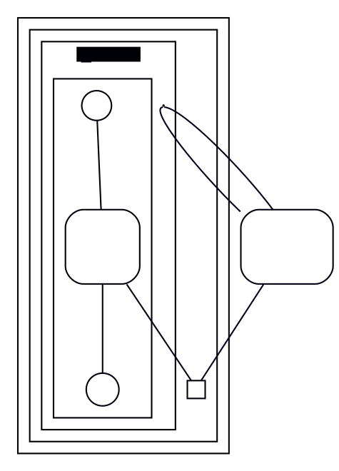

# Border-point cluster (`rank=sink` port node + `ee` subgraph): inner nodes placed 2-17 px off native

**Impact:** `state/viroxo-69-fito663` (93 attribute diffs, every one a 2-3 px
x shift of the `comp1` cluster's content and a 17 px shift of its `[*]` start;
cluster rect 109 px wide against the jar's 112). The same mechanism is the
pre-existing 8 px on the ten `state__hist-*` rows of
`oracle/goldens/diagram-style-scope.json` (journal row 12 of
`plans/state-divergence-drive`). Engine: `@knowvah/dot-engine` 2.4.0 vs real
`dot` 16.1.0 (homebrew). Found by plantuml-ts mission `state-divergence-drive`,
task T6c, 2026-11-04. Our DOT text equals the jar's `svek-1.dot` (`dotEqual`
true); only the layout differs (`layoutEqual` false).

**Finding.** A state composite with an exit point: the cluster carries a
`{rank=sink; sh0010;}` group and a `shape=rect` 0.1667 in port node, an inner
`cluster6ee` subgraph holding a `shape=point` anchor (`zaent0001`) and an inner
`cluster6i` with the real content, plus `sh0012->sh0010:P` (an edge into the
port node's `:P` compass) and two edges on the anchor. Node sizes and the
cluster nesting are identical on both sides; the positions inside the cluster
are not.

## Repro



`dot -Tdot` (16.1.0), `pos` of the cluster's nodes (points):

```
sh0011 (start)  61,242
sh0012 (chk)    65,147
sh0013 (final)  65,51
sh0010 (ex)    128,51
cluster6 bb     16,16,142,293
```

The jar's SVG agrees with these to the pixel after its `6 - minX` move
(start 52, chk 56, ex 119; comp1 rect 7..119). Our render of the same DOT
through dot-engine, same frame:

```
start  41   (17 px left of chk; native: 4 px)
chk    58
ex    116   (58 px right of chk; native: 63 px)
comp1 rect 7..116 (109 wide; native 112)
```

Re-run: `/opt/homebrew/bin/dot -Tdot repro.dot` against
`DE.render(DE.parse(src), 'dot')` with `DE` = `@knowvah/dot-engine/dist/index.js`;
or `npx jiti /tmp/stdd-autolink-probe.mts viroxo-69-fito663` in this repo
(prints the root pass's node positions).

## Suspected graphviz C source

`lib/dotgen/rank.c` / `lib/dotgen/cluster.c` for the `rank=sink` subgraph
inside a cluster (`collapse_sets`, `cluster_leader`) and
`lib/dotgen/position.c` (`set_xcoords` with the compass port `:P` edge, whose
port offset enters `make_lrvn`/`ports_eq`). Confidence: LOW -- not traced into
dot-engine; the start node's 13 px extra offset from `chk` suggests the
x-coordinate pass, not ranking (ranks agree: both engines put ex and final on
the same rank).
