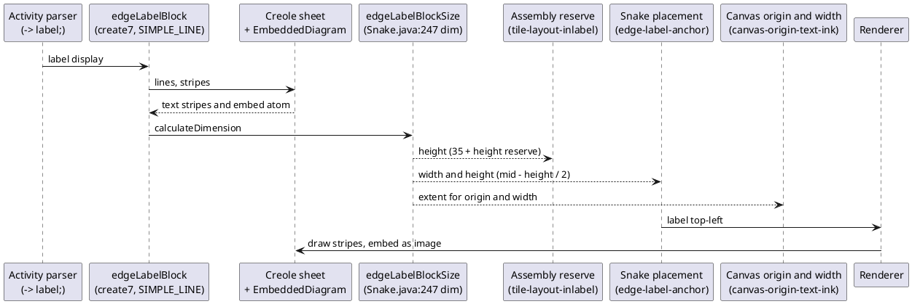

# Data flow: an activity-3 arrow label with an embed (aae)

Proposed flow after batch 2 (D3). The block measure is the one quantity every consumer reads; a label with no embed
line takes today's path unchanged. What the measure returns for an embed line is T1's finding.

