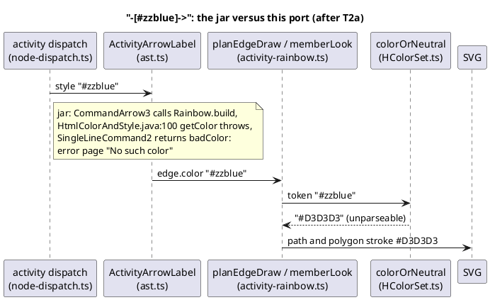

# Data flow: an unknown arrow colour

Proposed state after T2a. The jar errors at parse time; we carry the token to render time and resolve it there.

The swimlane (T2b) and note (T2c) sites follow the same shape, with `colorOrNeutral` applied where the parser stores
the token instead of at render time.
