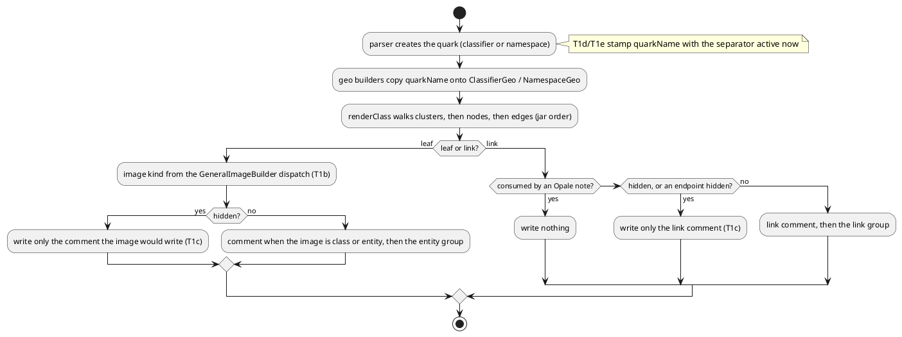

# Data flow: one class-engine leaf or link, after T1b-T1e

Before the mission, a hidden leaf or link returned before writing anything, every remaining classifier wrote
`<!--class X-->` whatever its kind, and names came from a `.` split or the display label.

Upstream: `SvekResult.java:70-101` (draw order, `UHidden`), `AbstractUGraphic.java:128-131` (the comment precedes the
hidden check), `SvgGraphics.java:1190-1195` (an empty group is dropped), `GeneralImageBuilder.java:107-242` (the
dispatch), `EntityImageClass.java:142`, `EntityImageDescription.java:295`, `Cluster.java:298-311`,
`Entity.java:686-688` (`getName`).
