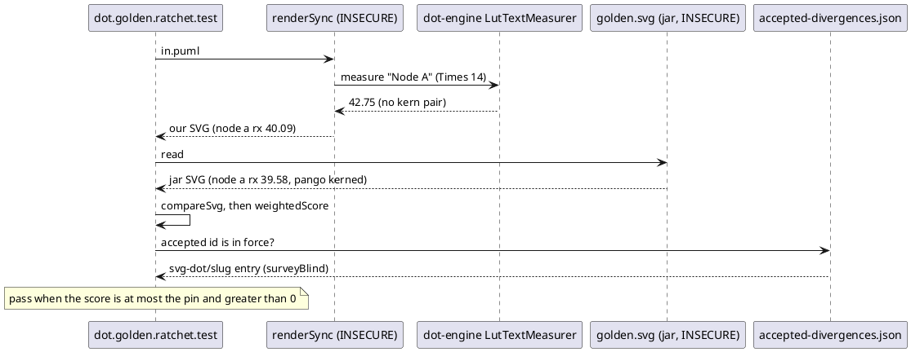

# Data flow: how an accepted @startdot row is measured

The jar and the port start from the same DOT. They part where text is measured. The ratchet holds the resulting score;
the survey never sees it.

