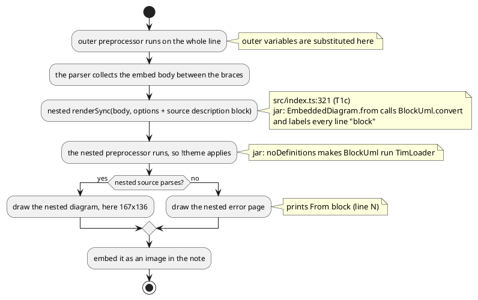

# Data flow: a one-line `{{ }}` embed, after T1c

The outer preprocessor sees `note top of a: \n{{\n!theme crt-amber\n...\n}}` as one line, so the directive survives
to the nested render. Since #3016 (in the pin `a720bdd`), the jar and the port both preprocess the body there. T1c
adds the `block` source label, which only an embedded error page prints.

