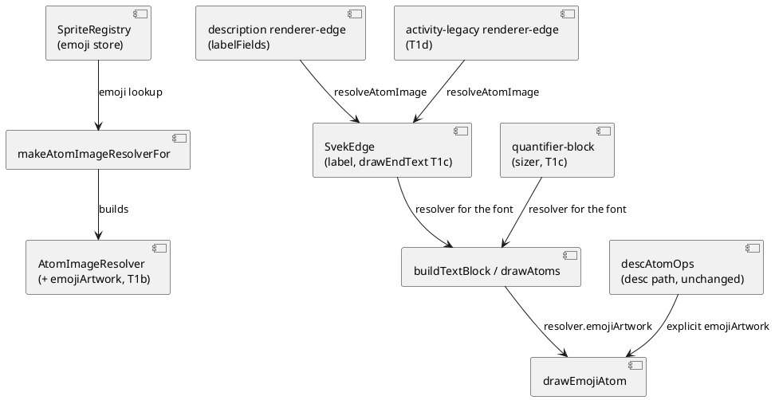

# Component map: who holds the emoji artwork after the mission

Not in this mission (D3): the class edge label and quantifier, the description cluster title sizer, and the state edge
label. Each one draws or measures an emoji through its own path.
