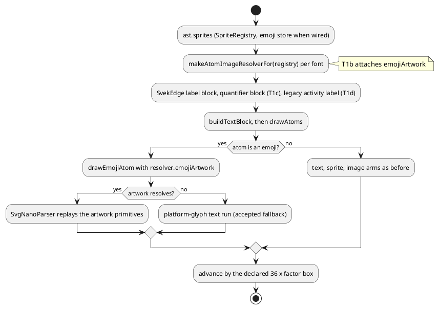

# Data flow: an emoji on an edge label, after T1b-T1d

Before the mission, `drawAtoms` drew every emoji as its platform-glyph text run, because no `buildTextBlock` caller
could hand it the emoji store.

Upstream: `SvekEdge.java:286-299,328-340` (label and quantifiers, one `skinParam`), `StripeSimple.java:245-250`
(`addEmoji`), `Emoji.java:111-118` (the global table), `AtomEmoji.java:66-68` and `Emoji.java:175-182` (the draw).
