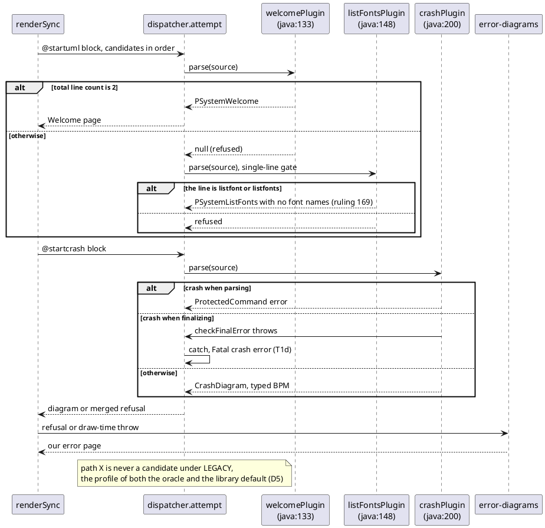

# Data flow

How a source reaches each of the four factories after this mission: Welcome, ListFonts, Crash and Path. The order is
the registry order, `PSystemBuilder.java:133-200`. Each candidate's parse runs inside `attempt`, and after T1d a throw
there becomes a "Fatal crash error" refusal while the loop goes on to the next factory (D7).

