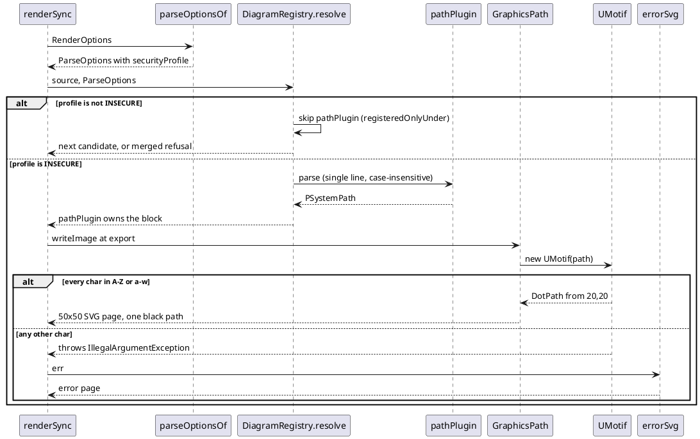

# Data flow — `path` under each profile

The render's profile reaches the registry through `ParseOptions` (D1). Under INSECURE the path plugin is a candidate,
and its page is drawn at export (D2). An invalid character throws there and becomes the error page (D3).

