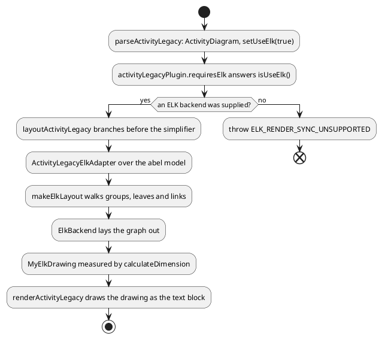

# Data flow

A legacy activity source with `!pragma layout elk`, after this mission. The svek branch is unchanged and drawn only
for contrast.

Without the pragma nothing changes: `CucaDiagramSimplifierActivity`, then `solveActivityLegacy` on dot-engine, then
the svek renderer.
