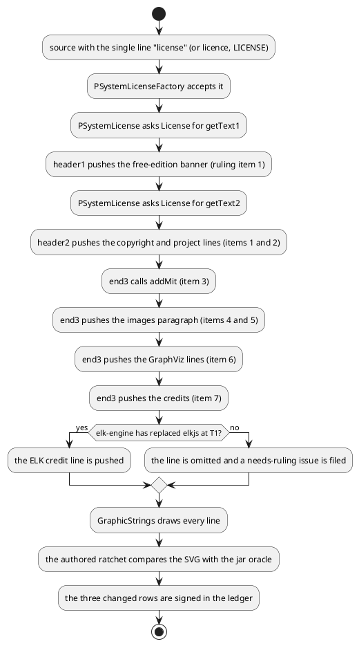

# Data flow: the license page

A `license` source reaches `PSystemLicense`, which draws `License#getText1` then `#getText2` as one block of text
lines. T1 changes only what the four `License` methods push; T2a and T2b account for the rows that change.

