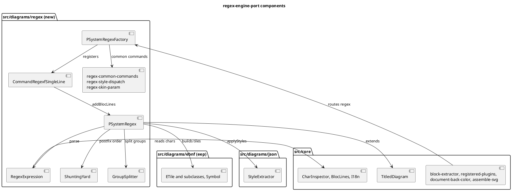

# Component map

What the mission creates (`src/diagrams/regex/`) and what it imports. Rendered through the jar at planning (parses as
DESCRIPTION). The two cross-package edges into `ebnf` and `json` are the layering entries of D1 and D3.

