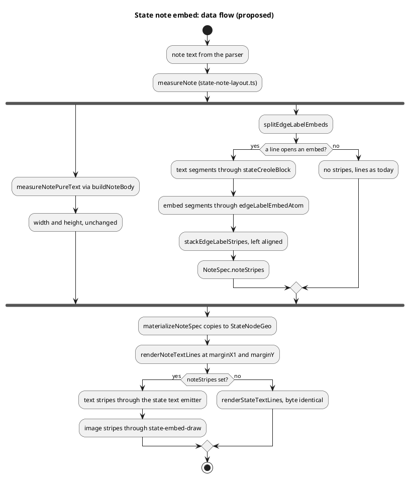

# Data flow: a state note with an embedded block

The note's size already comes from `buildNoteBody` (unchanged). This mission adds the stripe path beside it, and the
draw reads the stripes when they exist.

