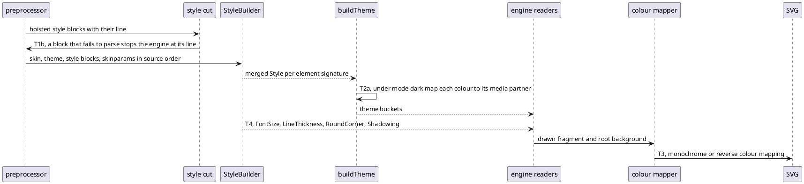

# Data flow: where a style colour and property come from (D2, D3, D6, D7)

Upstream does all of this on one `UGraphic`: the builder is fed in storage order (`SkinParam.java:227-234`), every
colour is an `HColor` carrying its `@media` partner, and `TitledDiagram#muteColorMapper` maps the output once
(`TitledDiagram.java:292-313`). The port stores hex strings in the theme, so dark mode is applied when the theme is
built (D2), and the other mappers run over the finished fragment (D6).
