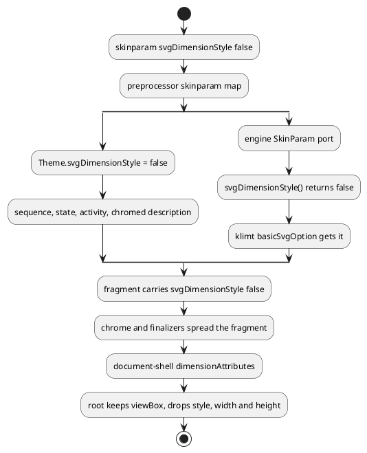

# Data flow: the svgDimensionStyle flag, after batch 2

Before batch 2, only class and the unchromed description path carried the flag to the shell.

Upstream: `TextBlockExporter.java:418-421` (the option), `SkinParam.java:1216-1218` (the read),
`SvgGraphics.java:795-799` (the root attributes).
