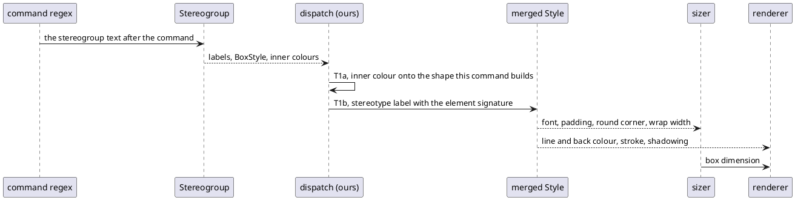

# Data flow: where a stereotyped box gets its look (D2, D3)

The jar reads every value in the last three arrows from one `Style` (`FtileBox.java:146-171`). Today the inner
colour reaches only an action body, and the stereotype reaches the renderer one colour at a time.
