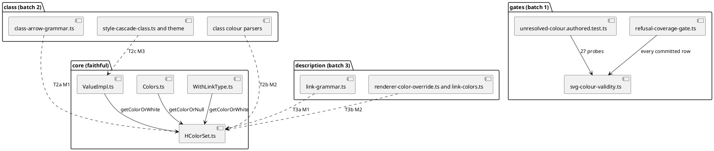

# Component map: where each mechanism is ported

Faithful core ports (already used by state, at 0 diffs) on the left. The class and description sites this mission
changes are on the right. The two gates read the rendered SVG.

