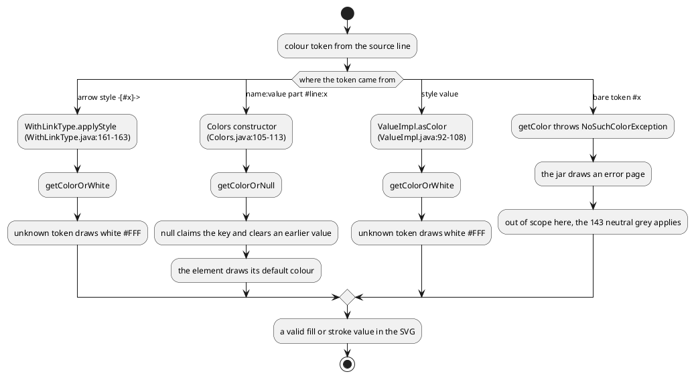

# Data flow: one unresolvable colour token

How a token `HColorSet` cannot parse travels, and which upstream method decides what the jar draws. Today's class and
description sites skip the decision and keep the raw token; this mission adds it at each site (D2).

