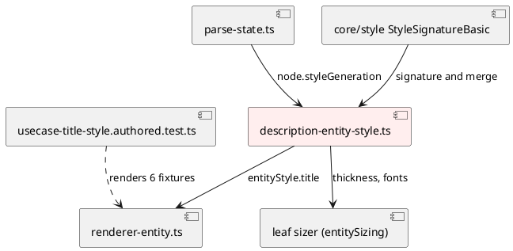

# Component map

The one module that changes (T1b), what feeds it and what reads it.

Only `description-entity-style.ts` changes in `src/`. The renderer already reads `entityStyle.title` for every symbol.
