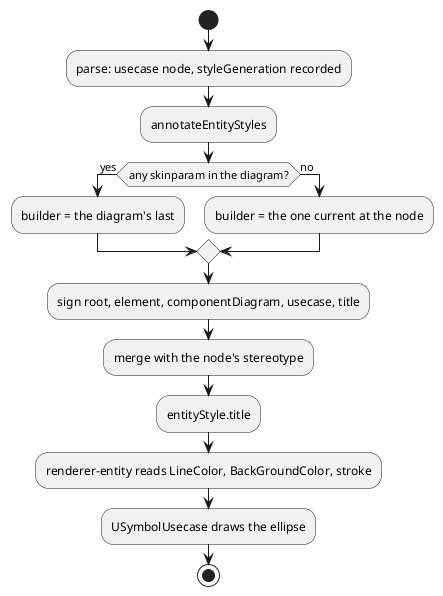

# Data flow: a use case's border style

Where the usecase's `title` style comes from, after T1b. Before T1b, the signature had no `title` part and the builder
was always the diagram's last one.

Upstream: `Entity.java:755-767` (the builder), `EntityImageDescription.java:142-171` (signature and reads),
`GeneralImageBuilder.java:169-175` (the dispatch that makes this path the one a use case takes).
