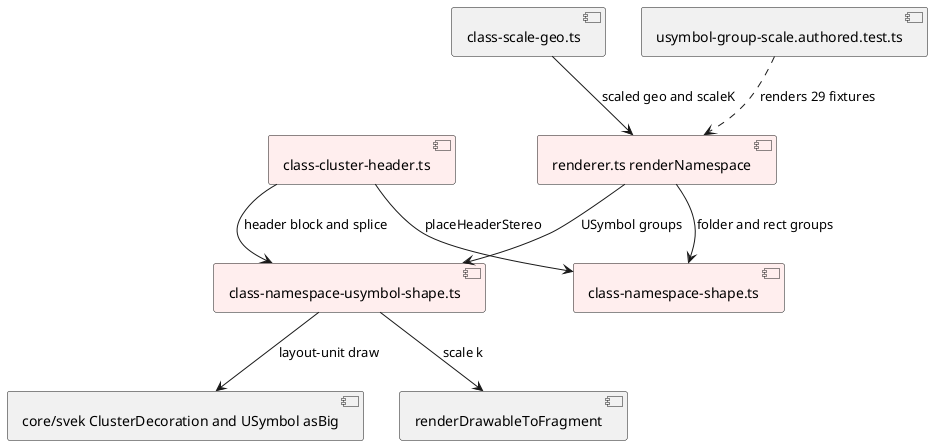

# Component map

The modules the mission changes (highlighted), what feeds them and what checks them.

`core/svek` and the `USymbol` classes are read-only here: they are shared with the description engine, which is
already conformant under scale (`desc-rectangle`).
