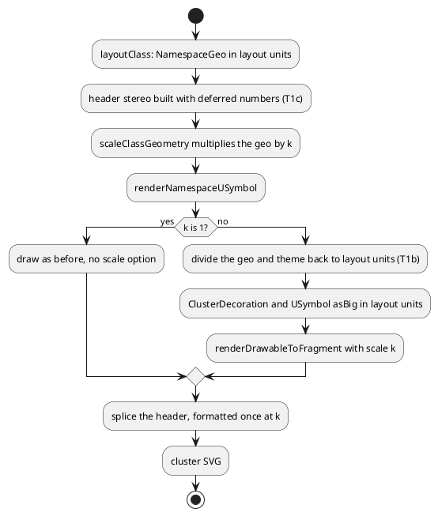

# Data flow: a scaled USymbol group, after T1b and T1c

Before the mission, the geo was scaled first and drawn at scale 1, so every `asBig` literal stayed at 1 and the
pre-formatted header stereo was spliced unscaled.

Upstream: `SvgGraphics.java:467-474` (one multiply-then-format per number), `Cluster.java:367-374` and
`ClusterDecoration.java:66-92` (the draw), `ClusterHeader.java:173-220` (the stereo block).
