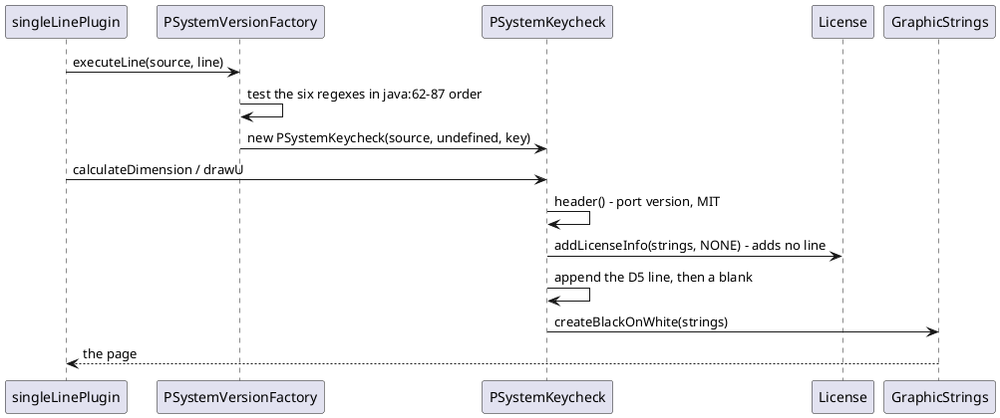

# Data flow: a one-line key-tool source

How `@startuml` / `keycheck abc123` / `@enduml` reaches a page after this mission. The factory tries the regexes in
upstream's order (D1); the key classes build one black-on-white text block (D2, D3).

`testdot` takes the same path through `PSystemVersion.createTestDot`, whose second line reads `DOT_ENGINE_VERSION`
from `src/core/version.ts` (D4) and never calls the layout engine (ruling 4).
